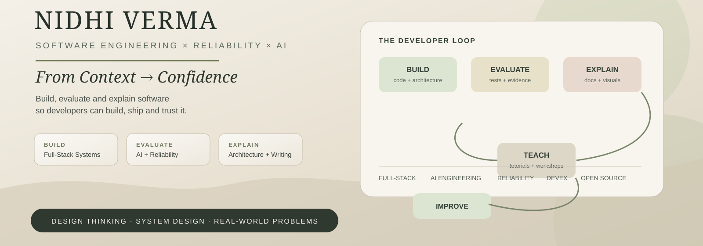

# STOK.EED × MountainBridge

### Short explanations. Real engineering. Evidence you can inspect.

**STOK.EED** makes complex engineering ideas easier to understand. **MountainBridge** is the deeper casebook behind that content: the models, source references, architecture notes, experiments, tests, and runnable examples that turn a short video into something a developer can inspect and learn from.

**Nidhi Verma · Senior Software Engineer · 11+ years in software engineering**

[Instagram · STOK.EED](https://www.instagram.com/stok.eed/) · [LinkedIn](https://www.linkedin.com/in/nidhiverma200/) · [Start with the content map](content/stokeed/02-series-to-casebook-map.md)

---

## Start here

Follow the path from a short explanation to deeper engineering work:

1. **See how the public content maps to code** — [STOK.EED series → casebook map](content/stokeed/02-series-to-casebook-map.md)  
   The current video themes, the repository follow-through each one deserves, and what is planned versus implemented.
2. **Understand tool calling** — [Agent From Zero: Tool](pattern-to-production/agent-from-zero/part-2-tool/README.md)  
   The model requests an action; application code validates and executes it.
3. **Understand the agent loop** — [Agentic Regression Investigator](projects/01-agentic-regression-investigator.md)  
   A design for connecting code changes to affected journeys, tests, evidence, and human review. **Design and implementation in progress.**
4. **Think beyond a demo** — [Production AI Application Engineering](projects/02-production-ai-application.md)  
   An architecture study of evaluation, observability, cost, latency, and safe operation—not a claim of production deployment.
5. **Read the engineering story** — [Regression Was a Context Problem](articles/01-regression-was-a-context-problem.md)  
   Why reliable answers depend on relevant context, traceable evidence, and testable outcomes.

## What STOK.EED is exploring

| Series | The question | What belongs in the casebook |
|---|---|---|
| **AI Systems, Explained** | Why might a support bot refund the wrong customer? | A synthetic agent with policy checks, bounded tools, approval gates, audit events, and tests. |
| **Model → Tools → Agent → MCP → Skills → SDK** | What does each layer do—and where are the boundaries? | Minimal examples, architecture flows, security notes, and a decision guide for when to build versus use an SDK. |
| **Reverse Engineering Agent (REA)** | How can an agent investigate software when source code is unavailable—and show what it does not know? | An authorised-lab workflow that separates evidence from inference and states safety limits. |
| **Java: 30 years of change** | Which language and runtime changes matter in practice? | A source-backed timeline with small examples and version/release checks. |
| **Production, Explained** | What actually goes wrong in payment systems, and which patterns help? | Synthetic examples for idempotency, retries, concurrency, timeouts, circuit breakers, sagas, and transactional outbox. |
| **Context engineering & regression** | How do we know a change has not broken an existing journey? | Traceable context, affected-flow reasoning, test evidence, evaluation, and honest reporting of uncertainty. |

The recurring method is **explain → inspect → build → test → improve**. A Reel is the entry point, not the proof.

## Featured work

### 01 · Agent From Zero — focused learning example
A small example for understanding tool calling and the boundary between a model's request and code execution.

[Open the example →](pattern-to-production/agent-from-zero/part-2-tool/README.md)

### 02 · Agentic Regression Investigator — in progress
A synthetic reference design for connecting a code change to affected components, user journeys, test evidence, uncertainty, and recommended human review.

[Read the project brief →](projects/01-agentic-regression-investigator.md) · [Read the companion article →](articles/01-regression-was-a-context-problem.md)

### 03 · Production AI Application Engineering — architecture study
A learning blueprint covering application boundaries, retrieval, tool use, evaluation, observability, cost, latency, and safe operation.

[Read the project brief →](projects/02-production-ai-application.md)

### 04 · Production, Explained — case-study roadmap
Six planned payment-system scenarios: a stuck payment, duplicate charge, concurrent withdrawals, a slow gateway, a failed cross-service handoff, and a missing notification. Each will use synthetic examples and tests; none is presented as a description of a particular bank's internal systems.

[See the content-to-code map →](content/stokeed/02-series-to-casebook-map.md)

## The standard for every case study

- **30-second read:** one precise claim and why it matters.
- **2-minute explanation:** architecture, data flow, trust boundaries, and trade-offs.
- **Evidence:** primary sources, versioned claims, assumptions, and unknowns.
- **Try it yourself:** runnable code and tests where an implementation exists.
- **Failure paths:** edge cases, invalid inputs, retries, limits, and recovery.
- **Honest status:** clearly label research, design, prototype, and tested work.

Not every topic is a completed implementation. A diagram is not a running system; a passing test is not proof of production readiness; a model's tool request is not proof that an action succeeded.

## Explore the repository

- [STOK.EED content map](content/stokeed/02-series-to-casebook-map.md) — connect each video series to engineering follow-through
- [Projects](projects/) — project briefs and implementation status
- [Articles](articles/) — engineering explanations
- [Diagrams](diagrams/) — visual models and architecture flows
- [Patterns](patterns/) — reusable engineering ideas
- [Pattern to Production](pattern-to-production/) — focused learning examples
- [Case Studies](case-studies/) — system investigations and applied reasoning
- [Research](research/) — references and technical exploration

## Engineering principles

- **Evidence over confident guesses.** Separate observed facts, inferences, and unknowns.
- **Bounded tools over unrestricted execution.** Validate inputs and keep sensitive actions under application or human control.
- **Tests over intuition.** Verify normal behavior and failure paths.
- **Security by default.** Use synthetic examples; never publish employer code, customer data, tokens, or credentials.
- **Current sources over stale snippets.** Recheck fast-changing SDKs, protocols, and language-release claims.
- **Teach what you can demonstrate.** Prefer a reproducible example over a diagram alone.

## Connect

Follow the short-form explanations on **[Instagram · STOK.EED](https://www.instagram.com/stok.eed/)** and connect professionally on **[LinkedIn](https://www.linkedin.com/in/nidhiverma200/)**.

If a Reel sparks a question, open an issue or discussion with the specific claim, example, or behavior you'd like to investigate.

---

MountainBridge is the engineering casebook; STOK.EED is the public learning stream. The shared promise is simple: understand the system, test the claim, and explain the result.
